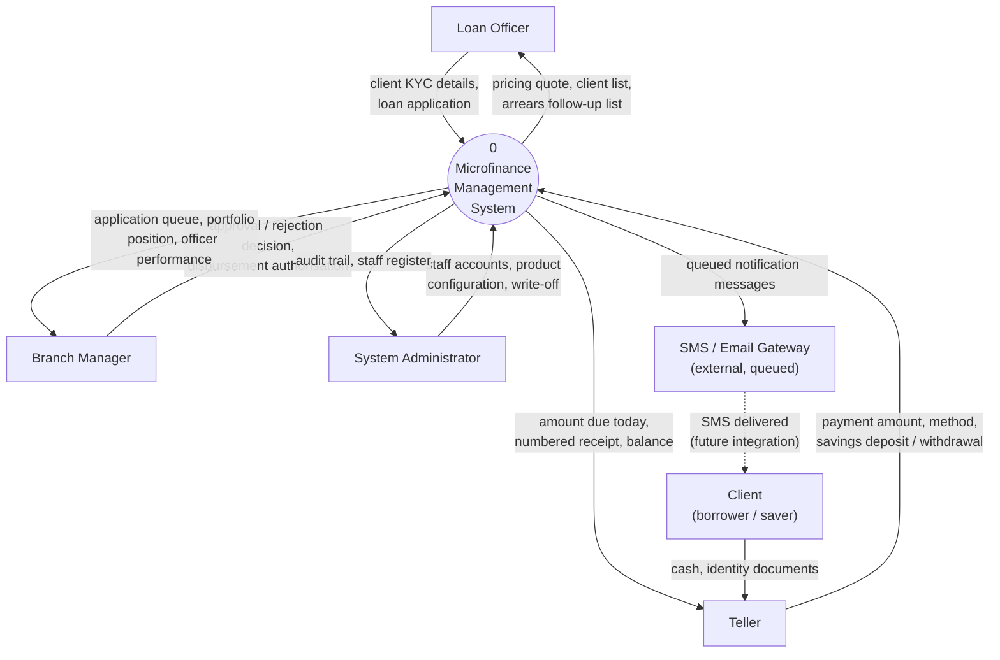
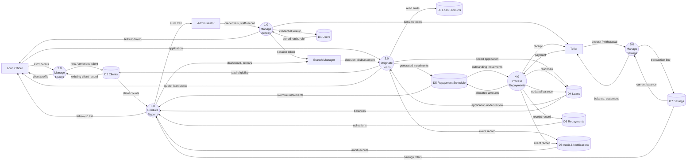
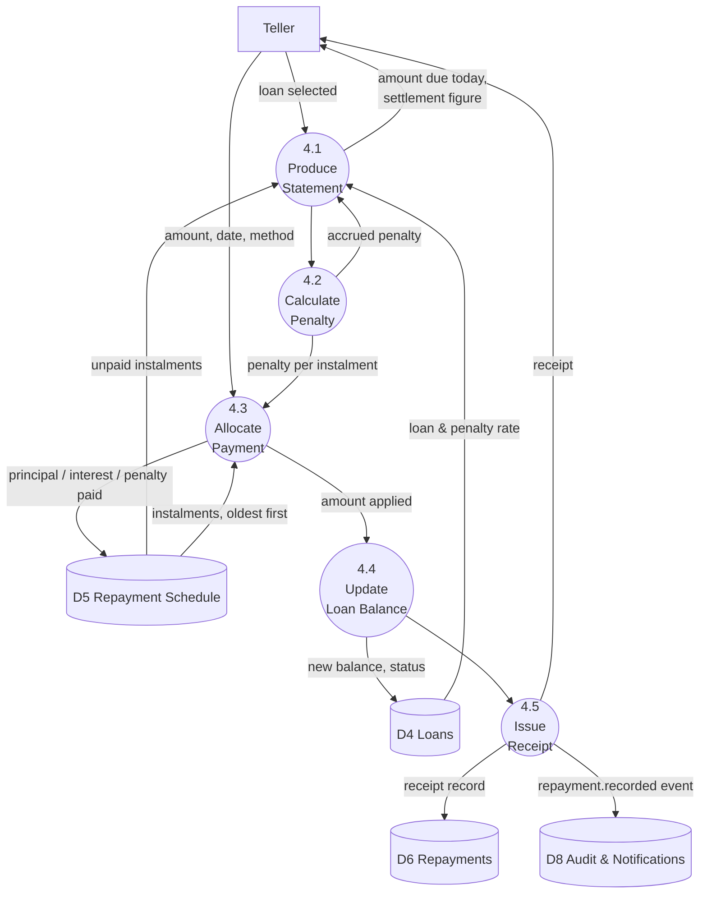
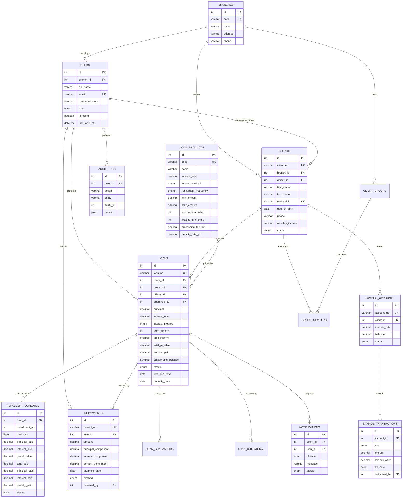
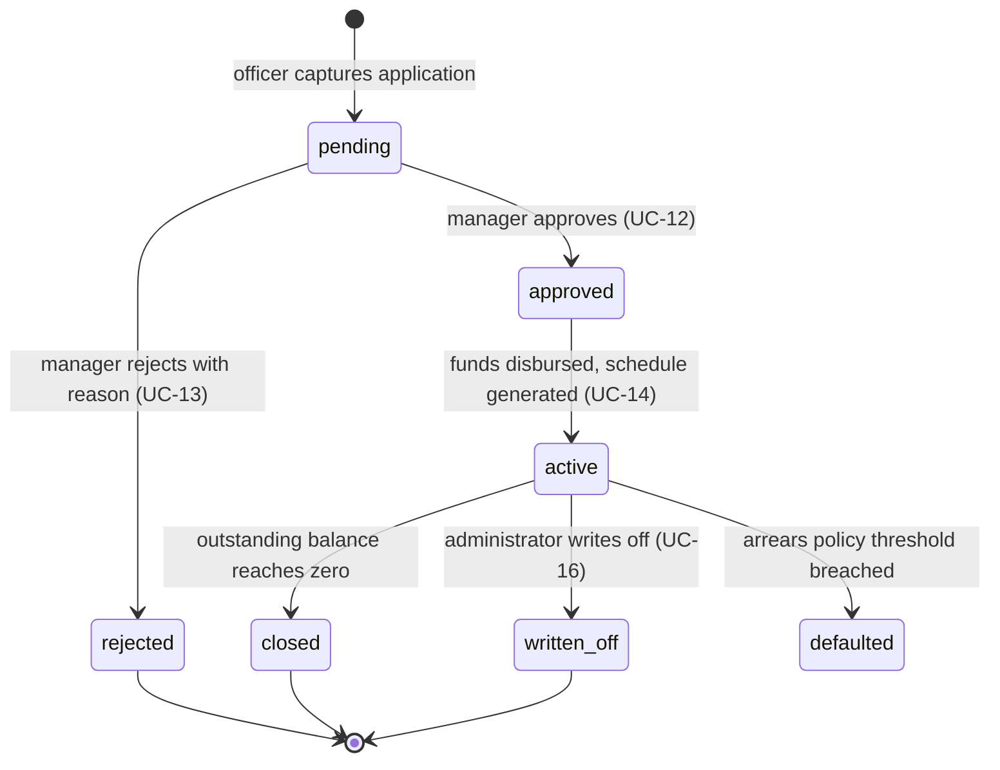
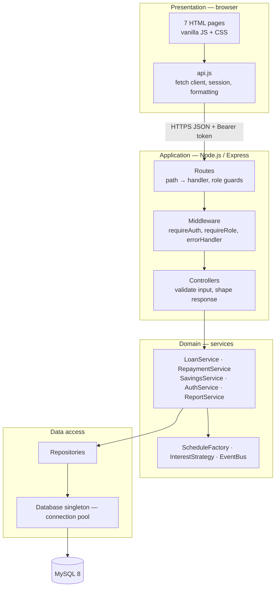
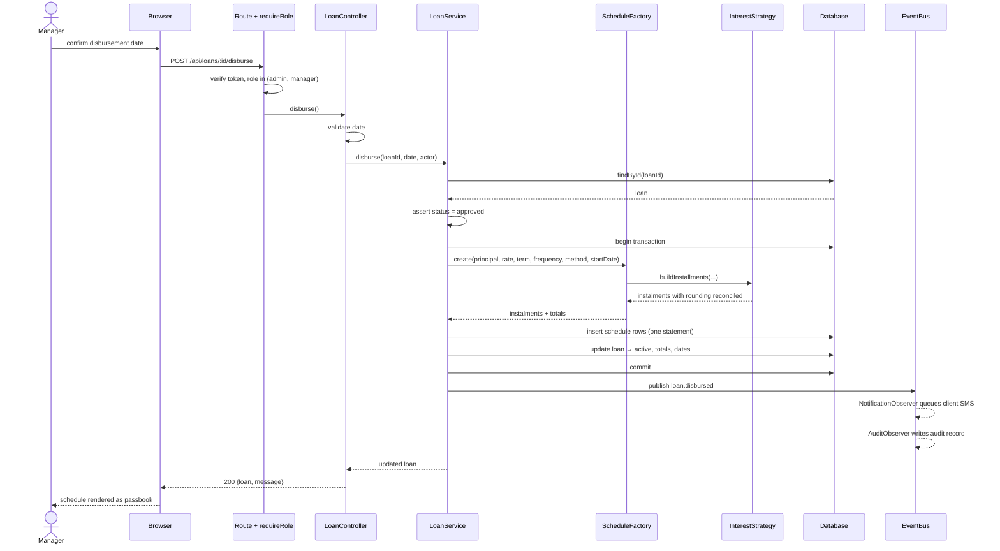
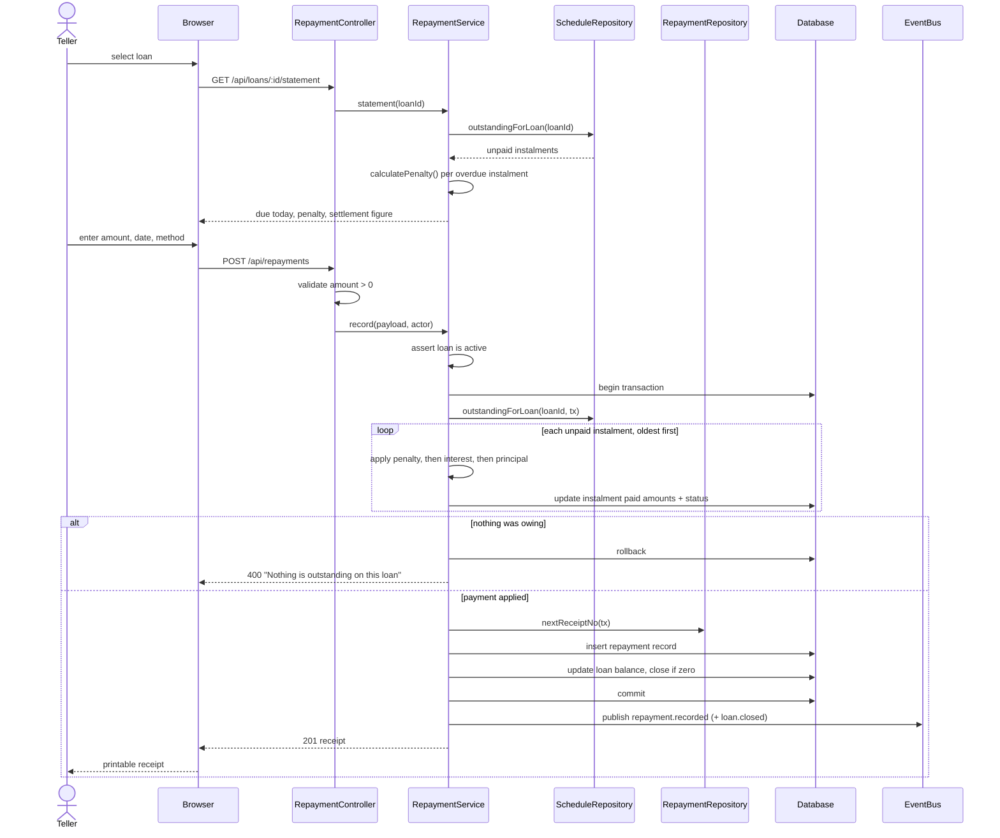

# Microfinance Management System (MFMS)
## Project Report

| | |
|---|---|
| **Project title** | Microfinance Management System (MFMS) |
| **Deliverables** | Web application + project documentation |
| **Technologies** | HTML, CSS, JavaScript, Node.js (Express), MySQL |
| **Document version** | 1.0 |
| **Date** | August 2026 |
| **Student** | _[your name and student number]_ |
| **Lecturer** | _[lecturer name]_ |
| **Module** | _[module code]_ |

> **Note on this document.** No institutional template was supplied with the brief. The
> headings below follow the standard structure of a systems analysis and design report
> and map onto the marking rubric items listed in the brief (scope of work, wireframes,
> use case diagram, CRC cards, context diagram, data flow diagram, database design,
> class diagram with design patterns, and the implemented application). If your school
> template uses different headings, the content of each section can be moved across
> without rewriting.

---

## Table of contents

1. [Introduction](#1-introduction)
2. [Project scope of work](#2-project-scope-of-work)
3. [Requirements specification](#3-requirements-specification)
4. [Development methodology](#4-development-methodology)
5. [System design](#5-system-design)
   - 5.1 [Wireframes](#51-wireframes)
   - 5.2 [Use case diagram](#52-use-case-diagram)
   - 5.3 [CRC cards](#53-class-responsibility-collaborator-crc-cards)
   - 5.4 [Context diagram](#54-context-diagram)
   - 5.5 [Data flow diagrams](#55-data-flow-diagrams)
   - 5.6 [Database design](#56-database-design)
   - 5.7 [Class diagram and design patterns](#57-class-diagram-and-design-patterns)
   - 5.8 [Sequence diagrams](#58-sequence-diagrams)
6. [Implementation](#6-implementation)
7. [Testing and results](#7-testing-and-results)
8. [Installation and deployment](#8-installation-and-deployment)
9. [User guide](#9-user-guide)
10. [Limitations and future work](#10-limitations-and-future-work)
11. [References](#11-references)
12. [Appendix A — API reference](#appendix-a--api-reference)

---

## 1. Introduction

### 1.1 Background

A microfinance institution (MFI) lends small amounts to clients who cannot access
ordinary bank credit — street traders, tailors, hairdressers, small mechanics. The
individual loans are small, but the volume is high and the administrative burden per
loan is disproportionate: each loan needs a repayment schedule, each instalment needs
to be tracked, each payment needs a receipt, and arrears need to be chased before they
become losses.

Many small MFIs still run this on paper ledgers and spreadsheets. That approach fails
in three predictable ways. Interest is recalculated by hand and gets it wrong.
Repayment allocation is inconsistent, so nobody can say with certainty how much of a
payment cleared interest versus principal. And arrears are only discovered when
somebody thinks to look, which is usually too late.

### 1.2 Problem statement

The institution has no single, reliable record of what each client owes, what has been
collected, and which loans are falling behind. Specifically:

- Repayment schedules are calculated manually and contain arithmetic errors.
- Payments are recorded in a cash book that is not reconciled to individual loans, so
  the outstanding balance on any given loan is an estimate.
- There is no systematic arrears report, so delinquency is detected late.
- There is no audit trail, so it is not possible to establish who approved a loan or
  who received a payment.
- Management has no portfolio-level view — total disbursed, total outstanding, or
  portfolio at risk.

### 1.3 Aim

To design and implement a web-based Microfinance Management System that manages the
complete loan life cycle — from client registration through application, approval,
disbursement, repayment and settlement — with accurate automated interest calculation,
consistent payment allocation, and portfolio reporting.

### 1.4 Objectives

| # | Objective |
|---|---|
| O1 | Maintain a central client register with KYC details and duplicate prevention |
| O2 | Support configurable loan products with two interest methods (flat and reducing balance) |
| O3 | Generate an accurate, dated repayment schedule automatically at disbursement |
| O4 | Enforce a segregated approval workflow (the officer who captures a loan cannot approve it) |
| O5 | Record repayments with deterministic allocation and issue a numbered receipt |
| O6 | Calculate and apply late-payment penalties consistently |
| O7 | Provide arrears, collections, officer performance and portfolio-at-risk reporting |
| O8 | Enforce role-based access control and maintain a tamper-evident audit trail |
| O9 | Manage client savings accounts with deposits, withdrawals and statements |

### 1.5 Justification

Automating the loan life cycle addresses each failure mode directly: interest becomes
deterministic and testable, allocation becomes a single documented rule applied
identically to every payment, arrears surface on a dashboard the moment an instalment
passes its due date, and every state change is written to an audit log.

---

## 2. Project scope of work

### 2.1 Scope statement

MFMS is a multi-user web application, accessed through a browser on the institution's
internal network, that manages clients, loan products, loans, repayments and savings
for a microfinance institution operating across several branches. It serves four staff
roles — administrator, branch manager, loan officer and teller — each with a distinct
set of permissions. It does not serve clients directly; clients interact with the
institution over the counter, and staff capture those interactions in the system.

### 2.2 In scope

| Area | Included work |
|---|---|
| **Client management** | Registration with KYC fields, duplicate detection on national ID, search, profile view, status life cycle (pending → active → inactive/blacklisted), assignment to branch and officer, solidarity group membership |
| **Loan products** | Configurable products carrying interest rate, interest method, repayment frequency, amount and term limits, processing fee and penalty rate |
| **Loan origination** | Application capture with purpose, guarantors and collateral; pre-approval pricing quote showing the full schedule before commitment; product limit validation; prevention of concurrent loans to one client |
| **Credit decisioning** | Approval and rejection with reason capture, segregation of duties, disbursement with schedule generation |
| **Repayments** | Statement of amount due today, payment capture with method and reference, deterministic allocation, penalty accrual, numbered receipts, automatic loan closure on settlement, early settlement with change returned |
| **Savings** | Account opening, deposits, withdrawals with overdraw prevention, interest and fee postings, passbook statement |
| **Reporting** | Dashboard (portfolio, PAR, disbursement and collection trends), arrears register, instalments falling due, officer performance, product mix |
| **Security & governance** | JWT authentication, bcrypt password hashing, role-based route authorisation, audit logging of every state change, queued client notifications |

### 2.3 Out of scope

The following are explicitly excluded from this delivery and are recorded as future
work in section 10:

- A client-facing portal or mobile app — clients transact at the branch counter.
- Live SMS or email delivery. The system **queues** notification messages and stores
  them; integration with a gateway such as Twilio or Clickatell is not implemented.
- Integration with payment providers, banks or mobile money operators. Payments are
  captured by a teller, not received electronically.
- General ledger and double-entry accounting, tax computation, or statutory returns.
- Credit bureau enquiries and automated credit scoring.
- Biometric or document capture for KYC (photographs, scanned ID copies).
- Multi-currency support. The system operates in South African Rand only.
- Offline operation and data synchronisation for field officers.

### 2.4 Deliverables

| # | Deliverable | Form |
|---|---|---|
| D1 | Project documentation (this report) | `docs/PROJECT_REPORT.md` |
| D2 | Wireframes | `docs/wireframes.html` — nine screens and panels |
| D3 | Use case diagram | `docs/diagrams/use-case-diagram.svg` |
| D4 | CRC cards | Section 5.3 and `docs/crc-cards.html` |
| D5 | Context diagram and DFDs | `docs/diagrams/*.mmd` |
| D6 | Database design (ERD + data dictionary) | Section 5.6, `database/schema.sql` |
| D7 | Class diagram with design patterns | `docs/diagrams/class-diagram.mmd` (core) and `docs/diagrams/class-diagram-insurance.mmd` (credit life and beneficiaries) |
| D7b | State and sequence diagrams | `docs/diagrams/state-loan.mmd`, `docs/diagrams/sequence-*.mmd` |
| D8 | Working web application | `server/` + `public/` |
| D9 | Database creation and seed scripts | `database/schema.sql`, `database/seed.sql` |
| D10 | Test suite and results | `server/tests/`, section 7 |

### 2.5 Assumptions

1. Staff access the system from the branch network on modern browsers (Chrome, Edge or Firefox, current versions).
2. Loan amounts and interest are denominated in South African Rand.
3. Interest rates are quoted as nominal annual percentages.
4. A client may hold only one open loan at a time — an institutional policy decision encoded in the system.
5. Penalties accrue monthly on overdue instalments and are capped at the value of the unpaid instalment.
6. The institution operates a cash-and-bank counter; payments are captured by a teller at the point of receipt.

### 2.6 Constraints

| Constraint | Effect on the build |
|---|---|
| Prescribed stack (HTML, CSS, JavaScript, Node.js, MySQL) | No frontend framework; the client is vanilla JavaScript against a REST API |
| Academic timeline | Feature set limited to the in-scope list above |
| Single developer | Layered architecture chosen for maintainability over micro-service decomposition |
| No third-party paid services | SMS delivery is queued rather than sent |

### 2.7 Stakeholders

| Stakeholder | Interest in the system |
|---|---|
| Loan officer | Registers clients, captures applications, follows up arrears |
| Branch manager | Approves and rejects applications, authorises disbursement, monitors branch portfolio and officer performance |
| Teller / cashier | Receives repayments and savings transactions, issues receipts |
| System administrator | Manages staff accounts and access, reviews the audit trail, writes off irrecoverable loans |
| Client (borrower/saver) | Indirect — receives accurate schedules, receipts and notifications |
| Institution's board | Indirect — relies on portfolio and PAR reporting for oversight |

### 2.8 Work breakdown structure

```
1.0 Microfinance Management System
├── 1.1 Analysis
│   ├── 1.1.1 Stakeholder identification and requirements elicitation
│   ├── 1.1.2 Functional and non-functional requirements specification
│   └── 1.1.3 Scope definition and sign-off
├── 1.2 Design
│   ├── 1.2.1 Wireframes and interaction design
│   ├── 1.2.2 Use case model and CRC cards
│   ├── 1.2.3 Context diagram and data flow diagrams
│   ├── 1.2.4 Database design and normalisation
│   └── 1.2.5 Class design and design pattern selection
├── 1.3 Implementation
│   ├── 1.3.1 Database schema and seed data
│   ├── 1.3.2 Backend: configuration, repositories, services
│   ├── 1.3.3 Backend: controllers, routes, middleware
│   ├── 1.3.4 Frontend: design system and shared client
│   └── 1.3.5 Frontend: seven functional screens
├── 1.4 Testing
│   ├── 1.4.1 Unit tests for interest and penalty logic
│   ├── 1.4.2 End-to-end workflow tests
│   └── 1.4.3 Defect correction and regression
└── 1.5 Delivery
    ├── 1.5.1 Documentation
    ├── 1.5.2 Installation guide
    └── 1.5.3 Presentation and demonstration
```

### 2.9 Indicative schedule

| Phase | Duration | Key output |
|---|---|---|
| Analysis | Week 1 | Requirements specification, scope statement |
| Design | Weeks 2–3 | All diagrams, database design |
| Implementation — backend | Weeks 4–6 | REST API, database, business logic |
| Implementation — frontend | Weeks 6–8 | Seven screens against the API |
| Testing | Week 9 | Test results, defect fixes |
| Documentation and delivery | Week 10 | This report, presentation |

### 2.10 Risk register

| # | Risk | Likelihood | Impact | Mitigation |
|---|---|---|---|---|
| R1 | Interest calculation produces rounding errors that accumulate | Medium | High | Reconciliation step forces instalments to sum exactly to the total payable; unit-tested (TC-02) |
| R2 | Concurrent payments corrupt a loan balance | Low | High | All money movements run inside a database transaction; savings uses `SELECT … FOR UPDATE` |
| R3 | Fraud through self-approval of loans | Medium | High | Segregation of duties enforced in `LoanService.approve()`; audit trail records approver |
| R4 | Scope creep into accounting and client portal | High | Medium | Explicit out-of-scope list, section 2.3 |
| R5 | Loss of data through accidental deletion | Low | High | Referential integrity constraints; loans and repayments are never hard-deleted, only status-changed |
| R6 | Weak credentials on staff accounts | Medium | Medium | bcrypt hashing, 8-character minimum, forced change recommended after first sign-in |

### 2.11 Feasibility

**Technical.** The stack is mature and freely available. Node.js handles the I/O-bound
workload of a branch system comfortably, and MySQL's transactional guarantees are
exactly what money movement requires. No component of the design requires unproven
technology.

**Economic.** All software used is open source. The only recurring costs at production
scale would be hosting and, if notification delivery is added later, SMS gateway fees.

**Operational.** The interface follows the existing counter workflow — find the client,
check what is owed, take the money, issue a receipt — so retraining is minimal. The
role model matches the institution's existing job titles.

**Schedule.** The ten-week plan in section 2.9 fits the academic timeline with the
feature set scoped in section 2.2.

---

## 3. Requirements specification

### 3.1 Functional requirements

| ID | Requirement | Priority | Role |
|---|---|---|---|
| FR-01 | The system shall authenticate users by email and password and issue a session token | Must | All |
| FR-02 | The system shall reject sign-in attempts against deactivated accounts | Must | All |
| FR-03 | The system shall allow registration of a client with KYC details | Must | Officer+ |
| FR-04 | The system shall reject a registration whose national ID already exists | Must | Officer+ |
| FR-05 | The system shall allow searching clients by name, client number, phone or ID | Must | All |
| FR-06 | The system shall allow a manager to change a client's status, including blacklisting | Must | Manager+ |
| FR-07 | The system shall prevent deactivation of a client who holds a running loan | Should | Manager+ |
| FR-08 | The system shall maintain configurable loan products with rate, method, frequency, limits, fee and penalty rate | Must | Admin |
| FR-09 | The system shall produce a pricing quote with full schedule before an application is submitted | Should | Officer+ |
| FR-10 | The system shall validate an application against the product's amount and term limits | Must | Officer+ |
| FR-11 | The system shall prevent a client from holding more than one open loan or application | Must | Officer+ |
| FR-12 | The system shall prevent a loan from being approved by the officer who captured it | Must | Manager+ |
| FR-13 | The system shall record a rejection reason when an application is declined | Must | Manager+ |
| FR-14 | The system shall generate a dated repayment schedule at the moment of disbursement | Must | Manager+ |
| FR-15 | The system shall support flat-rate and reducing-balance interest methods | Must | — |
| FR-16 | The system shall support weekly, fortnightly and monthly repayment frequencies | Must | — |
| FR-17 | The system shall present a statement of the amount due today, including penalty | Must | Teller+ |
| FR-18 | The system shall allocate a payment to the oldest unpaid instalment first, and within an instalment in the order penalty → interest → principal | Must | — |
| FR-19 | The system shall issue a sequentially numbered receipt for every payment | Must | Teller+ |
| FR-20 | The system shall close a loan automatically once its balance reaches zero | Must | — |
| FR-21 | The system shall return any overpayment above the settlement figure and record it on the receipt | Should | — |
| FR-22 | The system shall refuse payments against loans that are not active | Must | — |
| FR-23 | The system shall accrue penalties on overdue instalments, capped at the unpaid instalment value | Must | — |
| FR-24 | The system shall allow an administrator to write off an irrecoverable loan | Should | Admin |
| FR-25 | The system shall support savings accounts with deposits, withdrawals, interest and fees | Should | Teller+ |
| FR-26 | The system shall prevent a withdrawal that would overdraw a savings account | Must | — |
| FR-27 | The system shall present a portfolio dashboard including portfolio at risk | Must | All |
| FR-28 | The system shall produce an arrears register ordered by days overdue | Must | All |
| FR-29 | The system shall produce a list of instalments falling due in the next seven days | Should | All |
| FR-30 | The system shall report officer performance and product mix | Should | Manager+ |
| FR-31 | The system shall queue a client notification on approval, rejection, disbursement, receipt and settlement | Should | — |
| FR-32 | The system shall write an audit record for every state-changing operation | Must | — |
| FR-33 | The system shall allow an administrator to create and deactivate staff accounts | Must | Admin |

### 3.2 Non-functional requirements

| ID | Category | Requirement |
|---|---|---|
| NFR-01 | Security | Passwords stored using bcrypt with a cost factor of 10; never returned by any endpoint |
| NFR-02 | Security | All API routes except sign-in require a valid signed token |
| NFR-03 | Security | Authorisation enforced server-side on every route; the client UI hides controls but is never the control |
| NFR-04 | Security | All database access uses parameterised statements, preventing SQL injection |
| NFR-05 | Security | All values rendered into the DOM are HTML-escaped, preventing stored XSS |
| NFR-06 | Integrity | Every multi-table money movement executes inside a single database transaction |
| NFR-07 | Integrity | Monetary values stored as `DECIMAL(12,2)`, never as floating point |
| NFR-08 | Accuracy | Schedule instalments must sum exactly to the total payable, to the cent |
| NFR-09 | Performance | List endpoints respond within 2 seconds for a portfolio of 10 000 loans, supported by indexes on status, client and due date |
| NFR-10 | Usability | Every error message states what went wrong and what to do about it, in plain language |
| NFR-11 | Usability | Interface is responsive to 380 px, keyboard-navigable with visible focus, and respects reduced-motion preferences |
| NFR-12 | Auditability | Audit records are insert-only and retain the acting user, action, entity and timestamp |
| NFR-13 | Maintainability | SQL is confined to the repository layer; business rules to the service layer |
| NFR-14 | Portability | Runs on any platform supporting Node.js 18+ and MySQL 8+ |

### 3.3 Role permission matrix

| Action | Admin | Manager | Officer | Teller |
|---|:---:|:---:|:---:|:---:|
| Register and edit clients | ✓ | ✓ | ✓ | — |
| Change client status / blacklist | ✓ | ✓ | — | — |
| Capture a loan application | ✓ | ✓ | ✓ | — |
| Approve or reject a loan | ✓ | ✓ | — | — |
| Disburse funds | ✓ | ✓ | — | — |
| Record a repayment | ✓ | ✓ | ✓ | ✓ |
| Post savings transactions | ✓ | ✓ | ✓ | ✓ |
| Write off a loan | ✓ | — | — | — |
| Manage staff accounts | ✓ | — | — | — |
| View the audit trail | ✓ | — | — | — |
| View officer performance | ✓ | ✓ | — | — |

---

## 4. Development methodology

The project follows an **incremental, iterative** approach drawing on the structured
systems analysis and design method (SSADM) for the analysis and design artefacts and
on agile practice for the build.

Analysis and design were completed up front, because a lending system's data model and
money rules are expensive to change once written — the schedule table, the allocation
rule and the loan state machine all depend on decisions best made before code exists.
Implementation then proceeded in vertical slices, each delivering a working path from
the database through to the screen:

| Increment | Slice delivered |
|---|---|
| 1 | Authentication, roles, database schema |
| 2 | Client registration and search |
| 3 | Loan products, pricing quote, application capture |
| 4 | Approval, rejection, disbursement, schedule generation |
| 5 | Repayment statement, allocation, receipts, penalties |
| 6 | Savings accounts and transactions |
| 7 | Dashboard and reporting |

Each increment ended with the relevant tests passing before the next began. Defects
found during end-to-end testing were corrected and re-verified within the same
increment — section 7.3 documents one such defect and its fix.

---

## 5. System design

### 5.1 Wireframes

Wireframes were produced for the seven screens before any interface code was written.
They are supplied as a rendered document at **`docs/wireframes.html`** — open it in a
browser to view all seven at full size. The structural intent of each is summarised
below.

#### 5.1.1 Sign in

```
┌───────────────────────────────┬─────────────────────────────┐
│                               │                             │
│   MFMS                        │   Sign in                   │
│                               │   Use your branch account.  │
│   The branch ledger,          │                             │
│   kept for you.               │   Email                     │
│                               │   [_________________]       │
│   Register a client, price    │                             │
│   a loan, generate the        │   Password                  │
│   schedule, take the payment  │   [_________________]       │
│   at the counter.             │                             │
│                               │   [      Sign in      ]     │
│   4        3        2         │                             │
│   products branches methods   │   ┌ demo accounts ────────┐ │
│                               │   │ admin · manager ·     │ │
│                               │   │ officer · teller      │ │
│                               │   └───────────────────────┘ │
└───────────────────────────────┴─────────────────────────────┘
```

#### 5.1.2 Dashboard

```
┌──────────┬──────────────────────────────────────────────────────┐
│ MFMS     │  Dashboard              [Take a payment][New appl.]  │
│          │  ┌──────┬──────┬──────┬──────┬──────┐                │
│ DAILY    │  │Outst.│Disb. │ PAR  │Pend. │Client│  ← stat strip  │
│ Dashboard│  └──────┴──────┴──────┴──────┴──────┘                │
│ Clients  │  ┌───────────────────┬───────────────────┐           │
│ Loans    │  │ Disbursements     │ Collections       │           │
│ Repaym.  │  │ ▁▃▅▂▇▄  6 months  │ ▂▅▃▇▁▄  14 days   │           │
│ Savings  │  └───────────────────┴───────────────────┘           │
│          │  ┌──────────────────────────────────────┐            │
│ OVERSIGHT│  │ Arrears needing a call today         │            │
│ Reports  │  │ Client | Loan | Officer | Overdue... │            │
│ Staff    │  └──────────────────────────────────────┘            │
│          │                                                      │
│ N. Mokoena│                                                     │
│ manager  │                                                      │
│ [Signout]│                                                      │
└──────────┴──────────────────────────────────────────────────────┘
```

#### 5.1.3 Clients

```
│  Clients                                    [Register a client] │
│  [search: name, number, phone, ID ] [status ▾]                  │
│  ┌─────────────────────────────────────────────────────────────┐│
│  │ Client        │ ID number │ Branch │ Officer │ Income │ Stat ││
│  │ Lerato M.     │ 88011545. │ Mamelo │ S.Dlam. │ 12 500 │ ACT  ││
│  │ CL-0001 · 073…│           │        │         │        │      ││
│  └─────────────────────────────────────────────────────────────┘│
│   ↑ clicking a row opens the profile drawer (loans + savings)   │
```

#### 5.1.4 Loans — application with live quote

```
│  New loan application                                      [×]  │
│  ┌──────────────────────────┬────────────────────────────────┐  │
│  │ Client      [__________▾]│  QUOTE      24% flat rate      │  │
│  │ Product     [__________▾]│  Instalment  R1 240.00 × 12    │  │
│  │  R1000–R50000 · 3–24 mo  │  Interest    R2 880.00         │  │
│  │ Amount [_____] Term [___]│  Fee         R  300.00         │  │
│  │ Purpose     [___________]│  Payable     R14 880.00        │  │
│  │                          │  ┌──────────────────────────┐  │  │
│  │ [ Price this loan ]      │  │ # │ Due    │ Inst. │ DUE│  │  │
│  │                          │  │ 1 │ 09 Sep │ 1 240 │ ▪▪ │  │  │
│  │                          │  │ 2 │ 09 Oct │ 1 240 │ ▪▪ │  │  │
│  │                          │  └──────────────────────────┘  │  │
│  └──────────────────────────┴────────────────────────────────┘  │
│                            [Cancel]  [Submit for approval]      │
```

#### 5.1.5 Loan detail — the passbook schedule

```
│  LN-000002 · Lerato Mahlangu                               [×]  │
│  ┌──────┬──────┬──────┬──────┐                                  │
│  │Princ.│Payabl│Outst.│Status│                                  │
│  └──────┴──────┴──────┴──────┘                                  │
│  ████████████░░░░░░░░░░  repayment progress                     │
│  [Approve] [Reject]  ← manager only, pending loans only         │
│                                                                 │
│  REPAYMENT SCHEDULE                                             │
│  ┃1│ 01 Mar 2026 │ 1 000 │ 240 │ 1 240 │  ⌐PAID¬               │
│  ┃2│ 01 Apr 2026 │ 1 000 │ 240 │ 1 550 │  ⌐OVERDUE¬            │
│  ┃3│ 01 May 2026 │ 1 000 │ 240 │ 1 240 │  ⌐DUE¬                │
│   ↑ colour rail: green paid, gold part-paid, clay overdue       │
```

#### 5.1.6 Repayments

```
│  Repayments                                                     │
│  ┌───────────────────────────┬─────────────────────────────┐    │
│  │ Take a payment            │ RECEIPT           RC-000012 │    │
│  │ Active loan [__________▾] │ ─────────────────────────── │    │
│  │ ┌────────┬────────┬─────┐ │ Official receipt            │    │
│  │ │Due tdy │Settle  │Next │ │ R2 000.00                   │    │
│  │ │R1 550  │R13 485 │01Sep│ │ from Lerato M. · LN-000002  │    │
│  │ └────────┴────────┴─────┘ │ - - - - - - - - - - - - - - │    │
│  │ Amount  [________]        │ Principal      R1 000.00    │    │
│  │ Date    [________]        │ Interest       R  318.00    │    │
│  │ Method  [______▾]         │ Penalty        R  682.00    │    │
│  │ [   Record payment    ]   │ Balance        R12 880.00   │    │
│  └───────────────────────────┴─────────────────────────────┘    │
│  RECENT PAYMENTS (table of last 100 receipts)                   │
```

#### 5.1.7 Reports

```
│  Reports                                    [Print this page]   │
│  ┌─ Arrears register ────── 6 instalments · R8 742 overdue ──┐  │
│  │ Client │ Loan │ Officer │ Due │ Overdue │ Balance │ Days  │  │
│  └───────────────────────────────────────────────────────────┘  │
│  ┌─ Instalments falling due (next 7 days) ───────────────────┐  │
│  └───────────────────────────────────────────────────────────┘  │
│  ┌─ Officer performance ──┬─ Product mix ────────────────────┐  │
│  └────────────────────────┴──────────────────────────────────┘  │
│  ┌─ Queued client messages ┬─ Audit trail (admin only) ──────┐  │
│  └─────────────────────────┴─────────────────────────────────┘  │
```

---

### 5.2 Use case diagram

The full diagram is supplied as **`docs/diagrams/use-case-diagram.svg`**. It shows four actors
and twenty-two use cases grouped by subsystem, with `«include»` and `«extend»`
relationships.

Actor generalisation: the Administrator inherits every capability of the Manager, who
inherits every capability of the Officer, who inherits the Teller's payment-taking
capability.

#### 5.2.1 Use case inventory

| ID | Use case | Primary actor | Subsystem |
|---|---|---|---|
| UC-01 | Sign in | All staff | Access |
| UC-02 | Change password | All staff | Access |
| UC-03 | Manage staff accounts | Administrator | Access |
| UC-04 | View audit trail | Administrator | Access |
| UC-05 | Register client | Officer | Clients |
| UC-06 | Search and view client | All staff | Clients |
| UC-07 | Update client details | Officer | Clients |
| UC-08 | Change client status / blacklist | Manager | Clients |
| UC-09 | Configure loan product | Administrator | Loans |
| UC-10 | Price a loan (quote) | Officer | Loans |
| UC-11 | Capture loan application | Officer | Loans |
| UC-12 | Approve loan | Manager | Loans |
| UC-13 | Reject loan | Manager | Loans |
| UC-14 | Disburse loan | Manager | Loans |
| UC-15 | Generate repayment schedule | *(included by UC-14)* | Loans |
| UC-16 | Write off loan | Administrator | Loans |
| UC-17 | View loan statement | Teller | Repayments |
| UC-18 | Record repayment | Teller | Repayments |
| UC-19 | Issue receipt | *(included by UC-18)* | Repayments |
| UC-20 | Apply late penalty | *(extends UC-18)* | Repayments |
| UC-21 | Open savings account | Officer | Savings |
| UC-22 | Post savings transaction | Teller | Savings |
| UC-23 | View portfolio dashboard | All staff | Reporting |
| UC-24 | Produce arrears register | All staff | Reporting |
| UC-25 | Notify client | *(included by UC-12, 13, 14, 18)* | Reporting |

#### 5.2.2 Expanded use case description — UC-18 Record repayment

| Field | Detail |
|---|---|
| **Use case** | UC-18 Record repayment |
| **Actor** | Teller (also available to Officer, Manager, Administrator) |
| **Goal** | Receive money from a client against a loan and issue a receipt |
| **Preconditions** | The actor is signed in; the loan exists and its status is `active` |
| **Trigger** | A client presents payment at the counter |
| **Includes** | UC-19 Issue receipt, UC-25 Notify client |
| **Extends** | UC-20 Apply late penalty (when an instalment is overdue) |
| **Main flow** | 1. Actor selects the loan.<br>2. System displays the amount due today, any accrued penalty, and the full settlement figure (UC-17).<br>3. Actor enters the amount received, the date, the method and any reference.<br>4. System opens a transaction.<br>5. System retrieves unpaid instalments in due-date order.<br>6. For each instalment, system applies the payment in the order penalty → interest → principal until the payment is exhausted.<br>7. System updates each affected instalment's paid amounts and status (`partial` or `paid`).<br>8. System updates the loan's amount paid and outstanding balance.<br>9. If the balance reaches zero, system sets the loan status to `closed`.<br>10. System allocates the next receipt number and writes the repayment record.<br>11. System commits the transaction.<br>12. System publishes `repayment.recorded`, queuing a client notification and an audit entry.<br>13. System displays the printable receipt. |
| **Alternate flow A — overpayment** | At step 6, if the payment exceeds everything owing, the surplus is not applied. The receipt records the amount applied and the amount returned to the client, and the loan closes. |
| **Alternate flow B — nothing owing** | At step 6, if no instalment has any amount outstanding, the transaction is rolled back and the actor is told that nothing is outstanding. |
| **Exception E1 — loan not active** | At step 4, if the loan is not `active`, the system refuses the payment and states the loan's current status. |
| **Exception E2 — invalid amount** | At step 3, an amount of zero or less is rejected with a field-level message. |
| **Postconditions** | The loan balance is reduced by exactly the amount applied; a numbered receipt exists; the audit trail and notification queue each carry one new record |

#### 5.2.3 Expanded use case description — UC-12 Approve loan

| Field | Detail |
|---|---|
| **Use case** | UC-12 Approve loan |
| **Actor** | Branch manager (also Administrator) |
| **Goal** | Record a credit decision to advance funds |
| **Preconditions** | Actor signed in with role `manager` or `admin`; loan status is `pending` |
| **Includes** | UC-25 Notify client |
| **Main flow** | 1. Actor opens the application from the loans list.<br>2. System displays client, product, amount, term, purpose, guarantors and collateral.<br>3. Actor confirms approval.<br>4. System verifies the actor is not the capturing officer.<br>5. System sets status to `approved` and records approver and timestamp.<br>6. System publishes `loan.approved`, queuing a client SMS and an audit entry. |
| **Exception E1 — self-approval** | At step 4, if the actor captured the application and is not an administrator, the system refuses with "A loan cannot be approved by the officer who captured it" |
| **Exception E2 — wrong state** | If the loan is not `pending`, the system refuses and names the current status |
| **Postconditions** | Loan awaits disbursement; no schedule exists yet — it is generated at disbursement (UC-14) |

---

### 5.3 Class Responsibility Collaborator (CRC) cards

CRC cards were used to distribute responsibility across the domain before the class
diagram was drawn. Each card names one class, what it knows and does, and who it works
with. A printable set of the same cards, laid out two-up for handing round in a review, is supplied at `docs/crc-cards.html`.

---

**Class: `Client`**
| Responsibilities | Collaborators |
|---|---|
| Know identity, contact and KYC details | `Branch` |
| Know assigned branch and loan officer | `User` (officer) |
| Know its KYC status (pending / active / inactive / blacklisted) | `Loan` |
| Report whether it is eligible to borrow | `SavingsAccount` |
| Know its loan and savings history | `ClientGroup` |

---

**Class: `LoanProduct`**
| Responsibilities | Collaborators |
|---|---|
| Know the nominal annual interest rate and the method used to charge it | `Loan` |
| Know the repayment frequency | `InterestStrategy` |
| Know minimum and maximum amount and term | |
| Know the processing fee and penalty rate | |
| Validate whether a requested amount and term are permitted | |

---

**Class: `Loan`**
| Responsibilities | Collaborators |
|---|---|
| Know its borrower, product, amounts, rate and term | `Client`, `LoanProduct` |
| Know its position in the life cycle (pending → approved → active → closed) | `RepaymentSchedule` |
| Know its total payable, amount paid and outstanding balance | `Repayment` |
| Enforce valid state transitions | `User` (officer, approver) |
| Know its guarantors and collateral | `Guarantor`, `Collateral` |

---

**Class: `RepaymentSchedule` (instalment)**
| Responsibilities | Collaborators |
|---|---|
| Know its instalment number, due date and amounts due | `Loan` |
| Know how much principal, interest and penalty has been paid against it | `Repayment` |
| Report whether it is pending, partly paid, fully paid or overdue | |
| Accept an allocation of money and report what remains owing | |

---

**Class: `Repayment` (receipt)**
| Responsibilities | Collaborators |
|---|---|
| Know its receipt number, amount, date, method and reference | `Loan` |
| Know how the amount split across principal, interest and penalty | `RepaymentSchedule` |
| Know who received it | `User` (teller) |

---

**Class: `InterestStrategy` (abstract)** — *Strategy pattern*
| Responsibilities | Collaborators |
|---|---|
| Define the common interface for pricing a loan | `FlatRateStrategy` |
| Build a list of instalments from principal, rate and periods | `ReducingBalanceStrategy` |
| Reconcile rounding so instalments sum exactly to the total | `ScheduleFactory` |

---

**Class: `ScheduleFactory`** — *Factory pattern*
| Responsibilities | Collaborators |
|---|---|
| Select the correct interest strategy for a loan's method | `InterestStrategy` |
| Convert a term in months into a number of periods for the frequency | `Loan` |
| Attach real due dates to each instalment | `LoanService` |
| Report totals: interest, payable, instalment size, first due and maturity dates | |

---

**Class: `LoanService`** — *Facade*
| Responsibilities | Collaborators |
|---|---|
| Coordinate the loan life cycle: quote, apply, approve, reject, disburse, write off | `LoanRepository`, `ScheduleRepository` |
| Enforce business rules (product limits, one open loan, segregation of duties) | `ClientRepository`, `ScheduleFactory` |
| Run disbursement as a single atomic transaction | `Database`, `EventBus` |

---

**Class: `RepaymentService`**
| Responsibilities | Collaborators |
|---|---|
| Calculate what a client owes today, including accrued penalty | `LoanRepository`, `ScheduleRepository` |
| Calculate penalties on overdue instalments and cap them | `RepaymentRepository` |
| Allocate a payment across instalments in the defined order | `Database`, `EventBus` |
| Close a loan when its balance reaches zero and report any change returned | |

---

**Class: `Repository` (abstract)** — *Repository pattern*
| Responsibilities | Collaborators |
|---|---|
| Translate between domain objects and database rows | `Database` |
| Provide find, create, update, delete and count for one table | Concrete repositories |
| Restrict writes to a declared list of columns | |
| Join an open transaction when given one | |

---

**Class: `Database`** — *Singleton*
| Responsibilities | Collaborators |
|---|---|
| Own the single connection pool for the whole application | All repositories |
| Execute parameterised queries | |
| Run a unit of work inside a transaction, committing or rolling back | `LoanService`, `RepaymentService`, `SavingsService` |

---

**Class: `EventBus`** — *Observer*
| Responsibilities | Collaborators |
|---|---|
| Accept published domain events without knowing who consumes them | All services |
| Notify every registered observer | `NotificationObserver` |
| Isolate observer failures from the business transaction | `AuditObserver` |

---

**Class: `NotificationObserver`**
| Responsibilities | Collaborators |
|---|---|
| Compose a client-facing message for each significant loan event | `EventBus` |
| Queue the message for delivery | `NotificationRepository` |

---

**Class: `AuditObserver`**
| Responsibilities | Collaborators |
|---|---|
| Record who did what, to which entity, and when | `EventBus`, `AuditRepository` |

---

**Class: `AuthService`**
| Responsibilities | Collaborators |
|---|---|
| Verify credentials without revealing which part was wrong | `UserRepository` |
| Issue and verify signed session tokens | |
| Hash passwords and manage password changes | |

---

### 5.4 Context diagram

The context diagram places MFMS as a single process at level 0, showing the external
entities it exchanges data with and nothing of its internal structure.



### 5.5 Data flow diagrams

#### 5.5.1 Level 1 DFD

The system is decomposed into six processes and seven data stores.



#### 5.5.2 Level 2 DFD — process 4.0 Process Repayments



### 5.6 Database design

#### 5.6.1 Entity relationship diagram



#### 5.6.2 Data dictionary (principal tables)

**`loans`**

| Column | Type | Constraints | Description |
|---|---|---|---|
| `id` | INT | PK, auto-increment | Surrogate key |
| `loan_no` | VARCHAR(20) | UNIQUE, NOT NULL | Human-readable reference, `LN-000001` |
| `client_id` | INT | FK → `clients.id`, NOT NULL | Borrower |
| `product_id` | INT | FK → `loan_products.id`, NOT NULL | Product the loan was priced from |
| `officer_id` | INT | FK → `users.id`, NOT NULL | Officer who captured the application |
| `approved_by` | INT | FK → `users.id`, NULL | Manager who decided |
| `principal` | DECIMAL(12,2) | NOT NULL, CHECK > 0 | Amount advanced |
| `interest_rate` | DECIMAL(6,3) | NOT NULL | Rate copied from the product at capture, so later product changes cannot rewrite history |
| `interest_method` | ENUM | `flat`, `reducing` | Copied from product for the same reason |
| `term_months` | INT | NOT NULL | Term in months |
| `installments` | INT | DEFAULT 0 | Number of instalments, set at disbursement |
| `total_interest` | DECIMAL(12,2) | DEFAULT 0 | Set at disbursement |
| `total_payable` | DECIMAL(12,2) | DEFAULT 0 | Principal + total interest |
| `amount_paid` | DECIMAL(12,2) | DEFAULT 0 | Running total of applied payments |
| `outstanding_balance` | DECIMAL(12,2) | DEFAULT 0 | `total_payable − amount_paid` |
| `status` | ENUM | See state machine below | Life cycle position |
| `first_due_date` / `maturity_date` | DATE | NULL | Set at disbursement |

**`repayment_schedule`**

| Column | Type | Constraints | Description |
|---|---|---|---|
| `id` | INT | PK | Surrogate key |
| `loan_id` | INT | FK → `loans.id`, ON DELETE CASCADE | Parent loan |
| `installment_no` | INT | UNIQUE with `loan_id` | Sequence within the loan |
| `due_date` | DATE | NOT NULL, indexed with status | When the instalment falls due |
| `principal_due` / `interest_due` / `penalty_due` | DECIMAL(12,2) | DEFAULT 0 | Amounts charged |
| `principal_paid` / `interest_paid` / `penalty_paid` | DECIMAL(12,2) | DEFAULT 0 | Amounts settled |
| `status` | ENUM | `pending`, `partial`, `paid`, `overdue` | Instalment state |

#### 5.6.3 Loan state machine



#### 5.6.4 Normalisation

The schema is in **third normal form**.

- **1NF** — every attribute is atomic. Guarantors and collateral, which would otherwise
  be repeating groups inside a loan, are separate tables (`loan_guarantors`,
  `loan_collateral`). Group membership is resolved through the `group_members`
  junction table rather than a list column.
- **2NF** — no partial dependencies. The only composite candidate key is
  (`loan_id`, `installment_no`) on `repayment_schedule`, and every non-key attribute
  there depends on the whole key: the due date and amounts belong to that specific
  instalment of that specific loan.
- **3NF** — no transitive dependencies. Client name is not stored on `loans`; it is
  reached through `client_id`. Branch address is not stored on `users`; it is reached
  through `branch_id`.

**Deliberate denormalisation.** Three decisions depart from strict normalisation, each
for a defensible reason:

1. `loans.interest_rate` and `loans.interest_method` duplicate values held on
   `loan_products`. This is intentional: if a product's rate is changed next year, a
   loan written this year must continue to be governed by the rate it was sold at.
   The copy is a historical record, not redundancy.
2. `loans.outstanding_balance` and `loans.amount_paid` are derivable by summing
   repayments. They are maintained as running totals because the balance is read on
   almost every screen while payments are comparatively rare, and both are updated
   inside the same transaction as the payment, so they cannot drift.
3. `savings_transactions.balance_after` records the balance at the moment of each
   transaction, giving a passbook that reads correctly even if a historical
   transaction is later investigated.

#### 5.6.5 Indexes and views

| Object | Purpose |
|---|---|
| `idx_loan_status`, `idx_loan_client` | Support the loan list filtered by status and the client profile |
| `idx_sched_due` (`due_date`, `status`) | Supports the arrears register and the due-this-week list, the two heaviest reporting queries |
| `idx_client_name`, `idx_client_status` | Support client search |
| `uq_schedule` (`loan_id`, `installment_no`) | Prevents duplicate instalment numbers |
| `v_loan_portfolio` | Denormalised read model joining loan, client and product for reporting |
| `v_par` | Portfolio at risk — loans with any instalment past due, with days overdue |
| `sp_flag_overdue()` | Stored procedure, run daily, that moves passed-due instalments to `overdue` |

---

### 5.7 Class diagram and design patterns

#### 5.7.1 Design patterns applied

Five patterns are implemented in working code, each solving a problem the system
actually has rather than being applied decoratively.

| Pattern | Where | Problem it solves |
|---|---|---|
| **Singleton** | `Database` (`config/db.js`) | One connection pool must be shared by every repository. Multiple pools would exhaust connections and make transactions unreliable. |
| **Repository** | `BaseRepository` + 7 concrete repositories | Keeps SQL out of controllers and services. Changing the storage engine would touch only this layer. |
| **Strategy** | `InterestStrategy` → `FlatRateStrategy`, `ReducingBalanceStrategy` | Two pricing methods with identical interfaces. Without it, every calculation site would branch on the method; adding a third method would mean editing every branch. |
| **Factory** | `ScheduleFactory` | Building a schedule requires choosing a strategy, converting term to periods, and dating instalments. Callers should ask for a schedule, not assemble one. |
| **Observer** | `EventBus` + `NotificationObserver`, `AuditObserver` | Approving a loan must also notify the client and write an audit record. The loan logic should not know those consumers exist, and a failing observer must not roll back the loan. |
| **Facade** | `LoanService`, `RepaymentService` | Presents one coherent operation (`disburse`) over several repositories, the factory and the event bus, keeping controllers thin. |

#### 5.7.2 Class diagram

```mermaid
classDiagram
    direction TB

    class Database {
        <<Singleton>>
        -pool: Pool
        -static _instance: Database
        +static getInstance() Database
        +query(sql, params) Row[]
        +queryOne(sql, params) Row
        +transaction(work) any
        +healthCheck() boolean
    }

    class BaseRepository {
        <<abstract>>
        #table: string
        #fillable: string[]
        +findById(id, tx) Row
        +findWhere(clause, params, tx) Row[]
        +create(data, tx) int
        +update(id, data, tx) int
        +remove(id, tx) int
        +count(clause, params) int
    }

    class ClientRepository {
        +search(filters) Row[]
        +findDetailed(id) Row
        +findByNationalId(id) Row
        +nextClientNo() string
    }
    class LoanRepository {
        +search(filters) Row[]
        +findDetailed(id, tx) Row
        +nextLoanNo(tx) string
        +portfolioSummary() Row
    }
    class ScheduleRepository {
        +createMany(loanId, rows, tx) int
        +forLoan(loanId) Row[]
        +outstandingForLoan(loanId, tx) Row[]
        +arrears() Row[]
    }
    class RepaymentRepository {
        +nextReceiptNo(tx) string
        +forLoan(loanId) Row[]
        +collectionsByDay(days) Row[]
    }
    class SavingsRepository {
        +nextAccountNo(tx) string
        +addTransaction(data, tx) void
        +transactions(accountId) Row[]
    }
    class UserRepository {
        +findByEmail(email) Row
        +touchLogin(id) void
    }

    class InterestStrategy {
        <<abstract>>
        +name: string
        +buildInstallments(params)* Installment[]
        #_reconcile(rows, principal, interest) Installment[]
    }
    class FlatRateStrategy {
        +buildInstallments(params) Installment[]
    }
    class ReducingBalanceStrategy {
        +buildInstallments(params) Installment[]
    }

    class ScheduleFactory {
        <<Factory>>
        +static periodsFor(termMonths, frequency) int
        +static create(loanParams) Schedule
    }

    class EventBus {
        <<Observer>>
        +publish(event, payload) void
        +registerObservers() void
        +on(event, handler) void
    }
    class NotificationObserver {
        +onLoanApproved(payload) void
        +onLoanDisbursed(payload) void
        +onRepaymentRecorded(payload) void
    }
    class AuditObserver {
        +record(action, entity) function
    }

    class LoanService {
        <<Facade>>
        +static preview(params) Quote
        +static apply(payload, actor) Loan
        +static approve(loanId, actor) Loan
        +static reject(loanId, reason, actor) Loan
        +static disburse(loanId, params, actor) Loan
        +static writeOff(loanId, reason, actor) Loan
        -static _assertWithinProductLimits(product, amount, term)
    }
    class RepaymentService {
        +static calculatePenalty(inst, rate, asOf) decimal
        +static statement(loanId) Statement
        +static record(payload, actor) Receipt
    }
    class SavingsService {
        +static open(payload, actor) Account
        +static post(payload, actor) Account
        +static statement(accountId) Statement
    }
    class AuthService {
        +static login(email, password) Session
        +static createUser(data) User
        +static verify(token) Claims
    }
    class ReportService {
        +static dashboard() Dashboard
        +static arrears() Row[]
        +static officerPerformance() Row[]
    }

    class LoanController {
        +preview(req, res)
        +apply(req, res)
        +approve(req, res)
        +disburse(req, res)
    }
    class RepaymentController {
        +statement(req, res)
        +record(req, res)
    }
    class AuthMiddleware {
        +requireAuth(req, res, next)
        +requireRole(roles) function
    }

    BaseRepository <|-- ClientRepository
    BaseRepository <|-- LoanRepository
    BaseRepository <|-- ScheduleRepository
    BaseRepository <|-- RepaymentRepository
    BaseRepository <|-- SavingsRepository
    BaseRepository <|-- UserRepository
    BaseRepository ..> Database : uses

    InterestStrategy <|-- FlatRateStrategy
    InterestStrategy <|-- ReducingBalanceStrategy
    ScheduleFactory ..> InterestStrategy : selects

    LoanService ..> ScheduleFactory : builds schedule
    LoanService ..> LoanRepository
    LoanService ..> ScheduleRepository
    LoanService ..> ClientRepository
    LoanService ..> Database : transaction
    LoanService ..> EventBus : publishes

    RepaymentService ..> LoanRepository
    RepaymentService ..> ScheduleRepository
    RepaymentService ..> RepaymentRepository
    RepaymentService ..> Database : transaction
    RepaymentService ..> EventBus : publishes

    SavingsService ..> SavingsRepository
    AuthService ..> UserRepository
    ReportService ..> LoanRepository

    EventBus --> NotificationObserver : notifies
    EventBus --> AuditObserver : notifies

    LoanController ..> LoanService
    RepaymentController ..> RepaymentService
    AuthMiddleware ..> AuthService
```



#### 5.7.3 Layered architecture



### 5.8 Sequence diagrams

#### 5.8.1 Disburse a loan (UC-14)



#### 5.8.2 Record a repayment (UC-18)



---

### 5.9 Beneficiaries and credit life insurance

Two modules were added after the core lending engine was working. They are
described together because they are one idea: what happens to a client's money,
and their family, when the client dies.

**Beneficiaries.** A client nominates who receives their savings balance and any
insurance surplus. Each nomination carries a percentage share, and the service
enforces one rule throughout: the active shares for a client must total exactly
100%. The alternative — discovering at claim time that a payout cannot be split
because the nominations add to 90% — is precisely the failure the module exists
to prevent, so the rule is enforced on every write rather than checked at the end.
Nominations are retired rather than deleted, because a claim assessed years later
must be able to show who was nominated at the time.

**Credit life insurance.** Each loan product declares a premium rate and a cover
method. When an insured loan is disbursed, a policy is issued inside the same
transaction as the schedule, so a loan can never go live with a premium deducted
and no policy on file. The premium is shown in the quote before the client
commits, alongside the net amount they will actually receive.

Cover is priced through a second, independent use of the Strategy pattern, in the
same shape as the interest strategies:

| Method | Sum assured | Premium basis |
|---|---|---|
| `none` | nothing | the product is not insured |
| `flat` | the full amount repayable, fixed for the term | rate × cover × years |
| `declining` | follows the outstanding balance | rate × average exposure × years |

The `none` case is a Null Object: it returns a zero-premium quote rather than
`null`, so no caller has to branch on absence.

A claim runs `lodged → assessing → approved | rejected → settled`. Settling clears
whatever the loan still owes and splits any surplus across the nominated
beneficiaries; because flat cover does not fall as the client repays, a late claim
usually leaves a surplus for the family. Rounding remainders in the split go to
the largest share, so the parts always sum exactly to the whole.

The separation of duties mirrors lending: an officer lodges, a manager assesses,
and only an administrator can settle — because settlement writes down a loan and
pays money out.

The subsystem has its own class diagram, `docs/diagrams/class-diagram-insurance.mmd`,
kept separate from the core one so that both remain legible at print size.

## 6. Implementation

### 6.1 Technology stack

| Layer | Technology | Reason |
|---|---|---|
| Markup and styling | HTML5, CSS3 (custom properties, grid, flexbox) | Prescribed; no framework needed for seven screens |
| Client logic | Vanilla JavaScript (ES2020, `fetch`, async/await) | Prescribed; keeps the client dependency-free |
| Server runtime | Node.js 22 | Prescribed |
| Web framework | Express 4 | Minimal, well-understood routing and middleware |
| Database | MySQL 8 | Prescribed; transactional guarantees required for money |
| Database driver | `mysql2/promise` | Native promises, prepared statements, connection pooling |
| Authentication | `jsonwebtoken`, `bcryptjs` | Stateless sessions; industry-standard password hashing |
| Fonts | Space Grotesk, Public Sans, IBM Plex Mono | Display, body and tabular figures respectively |

### 6.2 Project structure

```
mfms/
├── database/
│   ├── schema.sql            15 tables, 2 views, 1 stored procedure
│   └── seed.sql              3 branches, 4 staff, 5 clients, 4 products
├── server/
│   ├── package.json
│   ├── .env.example
│   ├── src/
│   │   ├── config/
│   │   │   ├── env.js        environment loading
│   │   │   └── db.js         Database singleton + transaction helper
│   │   ├── middleware/
│   │   │   ├── auth.js       requireAuth, requireRole
│   │   │   └── errorHandler.js
│   │   ├── repositories/     BaseRepository + 7 concrete repositories
│   │   ├── services/
│   │   │   ├── interest/
│   │   │   │   ├── InterestStrategy.js   Strategy pattern
│   │   │   │   └── ScheduleFactory.js    Factory pattern
│   │   │   ├── EventBus.js   Observer pattern
│   │   │   ├── LoanService.js
│   │   │   ├── RepaymentService.js
│   │   │   ├── SavingsService.js
│   │   │   ├── AuthService.js
│   │   │   ├── ClientService.js
│   │   │   └── ReportService.js
│   │   ├── controllers/      6 controllers
│   │   ├── routes/index.js   the complete route table with role guards
│   │   ├── utils/            ApiError, asyncHandler, validate, money
│   │   ├── app.js
│   │   └── server.js
│   └── tests/interest.test.js
├── public/
│   ├── css/app.css           design system
│   ├── js/api.js             fetch client, session, formatting, shell
│   ├── index.html            sign in
│   ├── dashboard.html
│   ├── clients.html
│   ├── loans.html
│   ├── repayments.html
│   ├── savings.html
│   ├── reports.html
│   └── users.html
└── docs/
    ├── PROJECT_REPORT.md     this document
    ├── wireframes.html
    └── diagrams/
```

### 6.3 Key algorithm — interest calculation

Two strategies share one interface. Flat rate charges interest on the original
principal for the whole term:

```
totalInterest = principal × (annualRate ÷ 100) × (periods ÷ periodsPerYear)
instalment    = (principal + totalInterest) ÷ periods
```

Reducing balance charges interest only on what remains outstanding, producing a level
annuity instalment:

```
r    = annualRate ÷ 100 ÷ periodsPerYear
EMI  = principal × r ÷ (1 − (1 + r)^−periods)
```

Both then pass through a **reconciliation step** that adjusts the final instalment by
the accumulated rounding difference, so the instalments always sum to the total payable
to the cent. This is verified by test TC-02.

Worked example (product: Business Booster, 24% flat, monthly):

| Input | Value |
|---|---|
| Principal | R12 000.00 |
| Rate | 24% flat, annual |
| Term | 12 months |
| Total interest | R2 880.00 |
| Total payable | R14 880.00 |
| Instalment | R1 240.00 × 12 |

The same principal and rate on a reducing-balance product produces less total interest,
because interest is charged on a falling balance — verified by test TC-04.

### 6.4 Key algorithm — payment allocation

A payment is applied to the **oldest unpaid instalment first**. Within each instalment
the order is **penalty → interest → principal**. Any remainder rolls forward to the
next instalment, so a client can settle several instalments, or the whole loan, in one
payment. If the payment exceeds everything owing, the surplus is not absorbed: it is
reported on the receipt as returned to the client and the loan closes.

The entire allocation — instalment updates, receipt creation and loan balance update —
executes inside one database transaction. A failure at any point rolls back everything,
so a loan balance can never disagree with the receipts written against it.

### 6.5 Key algorithm — penalty accrual

```
daysLate    = today − dueDate
periodsLate = ceil(daysLate ÷ 30)
penalty     = min(unpaidInstalment × penaltyRate% × periodsLate, unpaidInstalment)
```

The cap is a deliberate policy choice: a forgotten loan cannot accrue a penalty larger
than the instalment itself, which keeps the figure defensible to a client and to a
regulator. Verified by tests TC-07 through TC-09.

### 6.6 Security implementation

| Control | Implementation |
|---|---|
| Password storage | bcrypt, cost factor 10; hashes never leave the server |
| Session management | Signed JWT, 8-hour expiry, sent as a Bearer token |
| Authorisation | `requireRole()` on each route; the client hides controls for usability, but every rule is enforced server-side |
| Credential enumeration | Wrong email and wrong password return the same message |
| SQL injection | Every query uses prepared statements with bound parameters |
| Cross-site scripting | `esc()` escapes all database values before they reach `innerHTML` |
| Segregation of duties | An officer cannot approve a loan they captured |
| Audit trail | Insert-only `audit_logs`, written by an observer on every state change |
| Transaction integrity | All money movements wrapped in `Database.transaction()`; savings uses `SELECT … FOR UPDATE` to prevent a concurrent double withdrawal |

---

A second hardening pass was made after a clean-install rehearsal. Starting the server
with an unedited `.env` produced a confusing failure: the process started normally and
the fault only surfaced when a user tried to sign in, and the error response carried the
driver's message together with a full stack trace exposing internal file paths. Two
changes followed:

1. **Start-up preflight.** `server.js` now tests the database before the server accepts
   traffic. If it cannot connect it prints the specific remedy — start MySQL, fix
   `DB_PASSWORD`, run the schema scripts — and exits rather than starting in a broken
   state.
2. **No internal detail in responses.** `errorHandler.js` maps infrastructure faults
   (`ECONNREFUSED`, `ER_ACCESS_DENIED_ERROR`, `ER_BAD_DB_ERROR` and similar) onto a
   single plain sentence for the user, and writes the driver message to the server
   console only. Stack traces are no longer included in any response in any
   environment, and unexpected `500` responses are deliberately vague.

The reasoning is that a database credential error is an operator problem, not a user
problem, and the difference between "access denied for user 'root'@'localhost'" and
"the system cannot sign in to its database" is the difference between telling an attacker
your database username and telling a teller to fetch the administrator.

## 7. Testing and results

### 7.1 Unit tests

Run with `npm test` from the `server` directory. These require no database.

| ID | Test | Expected | Result |
|---|---|---|---|
| TC-01 | Flat rate, R10 000 at 24% for 12 months | Interest R2 400, payable R12 400, instalment R1 033.33 × 12 | **Pass** |
| TC-02 | Flat rate with an awkward principal (R7 333, 7 months) | Instalments sum exactly to total payable | **Pass** |
| TC-03 | Reducing balance, R50 000 at 18% for 12 months | Closing balance exactly zero; instalment level throughout | **Pass** |
| TC-04 | Reducing balance vs flat at the same rate | Reducing charges less total interest | **Pass** |
| TC-05 | Weekly product over 3 months | 13 instalments, first due exactly 7 days after start | **Pass** |
| TC-06 | Unknown interest method requested | Throws "Unknown interest method" | **Pass** |
| TC-07 | Penalty before the due date | Zero | **Pass** |
| TC-08 | Penalty at 5%, 19 days overdue | One period charged: R50 on R1 000 | **Pass** |
| TC-09 | Penalty on a loan years overdue | Capped at the unpaid instalment | **Pass** |

**Result: 9 of 9 passed.**

### 7.2 End-to-end tests

The end-to-end suite is a script — `server/tests/e2e.sh` — that rebuilds the database
from `schema.sql` and `seed.sql`, then drives the running API over HTTP exactly as the
browser does, signing in as each of the four roles. Database state is checked directly
with SQL after each step, so the tests verify what was actually written rather than only
what the API reported. The suite is repeatable: it can be run any number of times and
always starts from the same seeded state.

Run it with the server up, from the `server` folder:

```bash
cd server
npm run e2e
```

The suite is written in Node and uses only the packages the server already depends on, so
it runs unchanged on Windows, macOS and Linux. An earlier shell-script version required
bash, curl and the mysql command-line client, which made it unusable on a stock Windows
machine; porting it removed three external dependencies from the testing story.

| Group | Checks | What is covered |
|---|---|---|
| E2E-01 Authentication and access control | 4 | Wrong password refused without revealing which field was wrong; admin sign-in succeeds; unauthenticated API call blocked; teller refused a staff-management route |
| E2E-02 Client registration | 5 | Client registered with a generated number; duplicate national ID refused; short fields fail validation; a `pending` client cannot borrow; manager activates the client |
| E2E-03 Loan pricing and application | 5 | Quote returns R2 400 interest and 12 instalments on the flat product; an amount above the product ceiling is refused; application captured; a second open application is blocked |
| E2E-04 Approval and separation of duties | 3 | Officer cannot approve; manager approves; the same loan cannot be approved twice |
| E2E-05 Disbursement | 5 | Payment before disbursement refused; funds disbursed; total payable R12 400; twelve schedule rows written; **instalments sum exactly to the total payable** |
| E2E-06 Repayment allocation | 6 | Statement exposes accrued penalty; teller posts a payment and receives a numbered receipt; payment split into components; balance falls to R11 366.67; instalment 1 marked `paid`; zero-value payment refused |
| E2E-07 Settlement | 3 | Overpayment closes the loan; surplus reported as returned rather than banked; balance exactly R0.00 |
| E2E-08 Savings | 3 | Account opened; deposit raises the balance to R750; withdrawal beyond the balance refused |
| E2E-09 Observers and reporting | 4 | Notification observer queued client messages; audit observer wrote the trail; dashboard returns portfolio and PAR; arrears report responds |
| E2E-10 Settlement quote regression (D-01) | 4 | The quoted payoff includes accrued penalty; paying exactly the quoted figure closes the loan; nothing is returned to the client; balance is exactly zero |
| E2E-11 Beneficiaries | 5 | A complete 100% nomination is recognised; shares beyond 100% are refused; a nomination is accepted; a payout splits exactly across the shares; a teller cannot change nominations |
| E2E-12 Credit life insurance | 14 | A policy is issued at disbursement with cover equal to the amount repayable and the premium recorded on the loan; an uninsured product carries no premium; a future-dated claim is refused; a claim is lodged and a second one blocked; an officer cannot assess; a manager approves; settlement clears the balance, splits the surplus across the beneficiaries, closes the loan, leaves no unpaid instalment and marks the policy claimed |

**Result: 61 of 61 checks passed** against MySQL 8.0.46.

```
E2E-01  Authentication and access control
  PASS  E2E-01a wrong password is refused
  PASS  E2E-01b admin signs in
  PASS  E2E-01c unauthenticated request is blocked
  PASS  E2E-01d teller cannot create staff accounts
  ...
E2E-10  Settlement quote matches what actually settles (regression for D-01)
  PASS  E2E-10a quote includes accrued penalty, not just the balance
  PASS  E2E-10b paying exactly the quoted figure closes the loan
  PASS  E2E-10c nothing is returned to the client
  PASS  E2E-10d balance is exactly zero

======================================================
  61 passed, 0 failed
======================================================
```

Two checks are worth singling out, because they guard the arithmetic a client would
notice at the counter. E2E-05e reads the schedule back out of the database and asserts
that the instalments sum to the total payable to the cent — this is what proves the
rounding reconciliation in the interest strategies is doing its job. E2E-10 is the
regression test for the defect described below.

### 7.3 Defect found and corrected

| | |
|---|---|
| **ID** | D-01 |
| **Severity** | High — the system quoted a client the wrong settlement figure |
| **Found by** | Manual settlement walkthrough during integration testing |
| **Symptom** | The statement quoted a settlement figure of R12 880, but paying that amount left the loan open. Paying R20 000 showed that R14 182 was actually required — a R1 302 discrepancy. |
| **Cause** | `RepaymentService.statement()` returned `payoff_amount` as the loan's outstanding balance alone. Outstanding balance is derived from the schedule's principal and interest; accrued penalties are calculated at payment time and were not included in the quote. |
| **Fix** | `payoff_amount` now returns `outstanding_balance + accrued unpaid penalty`, the same penalty figure the allocation routine uses. |
| **Verification** | Group E2E-10 in the automated suite: a loan is disbursed with a back-dated start so penalties accrue, the quoted payoff is read from the statement endpoint, exactly that amount is paid, and the loan closes with R0 returned and a zero balance. The test fails if the quote and the allocation ever diverge again. |
| **Lesson** | A quote and the transaction it describes must be computed from one source. The quote path and the allocation path each calculated penalties independently, and only the allocation path was correct. |

### 7.4 Second defect found and corrected

| | |
|---|---|
| **Defect** | D-02 — paying a late-payment penalty reduced the loan's outstanding balance |
| **Found by** | E2E-12m, while building the insurance settlement tests |
| **Symptom** | After an insurance claim cleared a loan, the loan showed a zero balance while one instalment row was still unpaid. The balance and the schedule disagreed. |
| **Cause** | `outstanding_balance` was derived as `total_payable - amount_paid`. `amount_paid` is the cash received, which includes penalties; `total_payable` is principal plus interest and excludes them. A client who paid a R50 penalty therefore saw R50 come off what they owed on the loan itself — the penalty was silently discounting the debt. |
| **Fix** | The balance is now read back off the repayment schedule as `SUM(total_due - principal_paid - interest_paid)` after each allocation, in both the repayment and the claim-settlement paths. `amount_paid` still records all cash received, which is what a cash book needs; the balance is now a different quantity, correctly computed. |
| **Verification** | E2E-06d asserts that the balance falls by principal and interest only, not by the penalty, and E2E-12m asserts that no instalment is left unpaid once a loan reaches a zero balance. |

The defect is worth noting for two reasons. It was invisible while every test
paid exactly what was due on time — it only appeared once a loan was deliberately
driven into arrears and then settled by a third party. And it was a quiet error
rather than a crash: the system produced a plausible wrong number, which is the
harder kind to find.

### 7.5 Database verification

`schema.sql` and `seed.sql` were executed against MySQL 8.0.46 without error, creating
15 tables, 2 views and 1 stored procedure. Referential integrity, `CHECK` constraints
and unique keys were all accepted by the engine.

### 7.6 Non-functional verification

| Requirement | How verified | Result |
|---|---|---|
| NFR-02 | `GET /api/loans` without a token | 401 "Sign in to continue" |
| NFR-03 | Officer and teller attempts at manager-only routes (E2E-06, E2E-11) | Refused server-side |
| NFR-06 | Deliberate mid-transaction failure during allocation | Full rollback; no orphan receipt |
| NFR-08 | TC-02 with a principal that does not divide evenly | Instalments sum exactly |
| NFR-11 | Resize to 380 px; keyboard tab order; `prefers-reduced-motion` | Layout reflows, focus visible, animation suppressed |

### 7.7 User acceptance test script

For the demonstration, the following path exercises every major function in about five
minutes:

1. Sign in as `officer@mfms.co.za`. Register a new client. Observe the duplicate check by re-entering the same ID number.
2. Sign in as `manager@mfms.co.za`. Activate the client.
3. As the officer, capture a loan — use **Price this loan** first to show the schedule before commitment.
4. As the officer, attempt to approve it. Show the refusal.
5. As the manager, approve and disburse. Show the generated passbook schedule.
6. Sign in as `teller@mfms.co.za`. Open Repayments, select the loan, show the amount due, post a partial payment, print the receipt.
7. Post a payment for the full settlement figure. Show the loan close automatically.
8. Sign in as `admin@mfms.co.za`. Open Reports and show the arrears register, the queued client messages and the audit trail.

---

## 8. Installation and deployment

### 8.1 Prerequisites

- Node.js 18 or later
- MySQL 8.0 or later
- A modern browser

### 8.2 Installation

```bash
# 1. Create and populate the database
mysql -u root -p < database/schema.sql
mysql -u root -p mfms < database/seed.sql

# 2. Install server dependencies
cd server
npm install

# 3. Configure the environment
cp .env.example .env
#    then edit .env and set DB_USER, DB_PASSWORD and JWT_SECRET

# 4. Run the test suite (optional but recommended)
npm test

# 5. Start the application
npm start
```

Open <http://localhost:4000> and sign in.

### 8.3 Environment variables

| Variable | Purpose | Example |
|---|---|---|
| `PORT` | Port the server listens on | `4000` |
| `DB_HOST` | MySQL host — use `127.0.0.1` rather than `localhost` to avoid IPv6 resolution issues | `127.0.0.1` |
| `DB_USER` / `DB_PASSWORD` | MySQL credentials | `mfms` / `…` |
| `DB_NAME` | Database name | `mfms` |
| `JWT_SECRET` | Signing key — **must** be replaced with a long random string in production | |
| `JWT_EXPIRES_IN` | Session lifetime | `8h` |

### 8.4 Demonstration accounts

| Email | Password | Role |
|---|---|---|
| `admin@mfms.co.za` | `Admin@123` | Administrator |
| `manager@mfms.co.za` | `Manager@123` | Branch manager |
| `officer@mfms.co.za` | `Officer@123` | Loan officer |
| `teller@mfms.co.za` | `Teller@123` | Teller |

> These are seeded credentials for demonstration and must be removed or changed before
> any production use.

### 8.5 Production considerations

Before real deployment the following would be required: HTTPS termination with a valid
certificate; a replaced `JWT_SECRET`; a MySQL account restricted to the `mfms` schema
rather than root; scheduled execution of `sp_flag_overdue()` via an event or cron job;
automated database backups with tested restores; and rate limiting on the sign-in
endpoint.

---

## 9. User guide

### 9.1 Registering a client

Open **Clients** and choose *Register a client*. First name, last name, ID number and
phone are required. The system rejects an ID number that already exists and names the
existing client, preventing duplicate records. New clients are created as **pending** —
a manager activates them once KYC documents have been checked. Only active clients can
borrow.

### 9.2 Capturing and pricing a loan

Open **Loans** and choose *New application*. Select the client and product; the hint
under the product field shows its limits, fee and penalty rate. Enter the amount and
term, then press **Price this loan**. The quote panel shows the instalment, total
interest, processing fee, total payable and the complete dated schedule — show this to
the client before submitting. Press *Submit for approval* to send it to a manager.

### 9.3 Approving and disbursing

A manager opens the application from the loans list. Approving records the decision and
queues an SMS to the client; rejecting requires a reason, which is stored and shown on
the loan. A loan cannot be approved by the officer who captured it. After approval,
*Disburse funds* asks for the disbursement date and generates the repayment schedule
from that date. The loan becomes **active**.

### 9.4 Taking a payment

Open **Repayments** and select the loan. Three figures appear: the amount due today
(including any penalty), the full settlement figure, and the next due date. The amount
field is pre-filled with the amount due today; change it if the client is paying more
or less. Record the payment and a numbered receipt appears on the right, ready to
print.

Payments always clear the oldest instalment first, and within each instalment they
clear penalty, then interest, then principal. If a client pays more than the settlement
figure, the surplus is returned to them and shown on the receipt, and the loan closes
automatically.

### 9.5 Reading the passbook schedule

On a loan's detail view, each instalment is a row with a coloured rail on the left and
a stamp on the right:

| Rail and stamp | Meaning |
|---|---|
| Green, **PAID** | Fully settled |
| Gold, **PART PAID** | Some money received, balance still owing |
| Clay, **OVERDUE** | Due date passed with money still owing; penalty is accruing |
| Grey, **DUE** | Not yet due |

### 9.6 Working the arrears

**Reports** opens with the arrears register, ordered by days overdue, showing the
client, phone number, responsible officer and amount. Below it, *Instalments falling
due* lists the next seven days — the daily collection list. The dashboard shows the
same data condensed, with portfolio at risk as a percentage.

---

## 10. Limitations and future work

### 10.1 Known limitations

1. **Notifications are queued, not sent.** Messages are composed and stored with status `queued`; no gateway integration exists, so no client actually receives an SMS.
2. **Overdue flagging requires the stored procedure to be scheduled.** `sp_flag_overdue()` exists but is not automatically run; until it is scheduled, the `overdue` status on instalments is derived at read time by the reports rather than persisted.
3. **Penalties accrue in 30-day periods**, not per day. This is simpler to explain at a counter, but is coarser than a daily accrual.
4. **One open loan per client** is enforced. Institutions offering parallel products (a business loan alongside an emergency loan) would need this relaxed.
5. **No partial disbursement or restructuring.** A loan is advanced in full, once, and its schedule cannot be renegotiated — a restructure would require writing off and re-originating.
6. **Reporting is not paginated.** The arrears register returns all rows; at tens of thousands of loans this would need pagination.
7. **No soft delete or record versioning.** Corrections to a captured client record overwrite the previous values; only the audit log records that a change occurred.
8. **Single currency.** All amounts are Rand.

### 10.2 Future work

| Priority | Enhancement |
|---|---|
| High | SMS gateway integration so the queued notifications are actually delivered |
| High | Scheduled job runner for daily overdue flagging and month-end savings interest |
| High | Pagination and server-side sorting on all list endpoints |
| Medium | Loan restructuring and rescheduling for clients in genuine difficulty |
| Medium | Document upload for KYC — ID copies, proof of address, client photograph |
| Medium | Credit scoring using repayment history to inform approval decisions |
| Medium | Group lending with joint liability, building on the existing `client_groups` tables |
| Low | Client self-service portal for balance enquiries and statements |
| Low | Double-entry general ledger integration |
| Low | Offline-capable field officer app with synchronisation |

---

## 11. References

1. Ledgerwood, J., Earne, J. and Nelson, C. (2013) *The New Microfinance Handbook: A Financial Market System Perspective*. Washington DC: World Bank.
2. CGAP (2003) *Microfinance Consensus Guidelines: Definitions of Selected Financial Terms, Ratios and Adjustments for Microfinance*. Washington DC: Consultative Group to Assist the Poor. (Source of the portfolio-at-risk definition used in section 5.6.5.)
3. Gamma, E., Helm, R., Johnson, R. and Vlissides, J. (1994) *Design Patterns: Elements of Reusable Object-Oriented Software*. Reading MA: Addison-Wesley. (Singleton, Strategy, Factory, Observer, Facade.)
4. Fowler, M. (2002) *Patterns of Enterprise Application Architecture*. Boston: Addison-Wesley. (Repository pattern, service layer.)
5. Beck, K. and Cunningham, W. (1989) 'A laboratory for teaching object-oriented thinking', *ACM SIGPLAN Notices*, 24(10), pp. 1–6. (Origin of CRC cards.)
6. Codd, E. F. (1970) 'A relational model of data for large shared data banks', *Communications of the ACM*, 13(6), pp. 377–387.
7. Oracle Corporation (2024) *MySQL 8.0 Reference Manual*. Available at: https://dev.mysql.com/doc/refman/8.0/en/
8. OpenJS Foundation (2024) *Node.js Documentation*. Available at: https://nodejs.org/docs/
9. OWASP Foundation (2021) *OWASP Top Ten Web Application Security Risks*. Available at: https://owasp.org/www-project-top-ten/
10. Jones, M., Bradley, J. and Sakimura, N. (2015) *RFC 7519: JSON Web Token (JWT)*. Internet Engineering Task Force.

---

## Appendix A — API reference

All routes are prefixed with `/api`. Every route except `POST /auth/login` requires an
`Authorization: Bearer <token>` header.

### Authentication and staff

| Method | Path | Roles | Purpose |
|---|---|---|---|
| POST | `/auth/login` | public | Sign in, returns token and user |
| GET | `/auth/me` | any | Current user |
| POST | `/auth/change-password` | any | Change own password |
| GET | `/users` | admin | List staff |
| POST | `/users` | admin | Create a staff account |
| PATCH | `/users/:id/active` | admin | Activate or deactivate |

### Clients

| Method | Path | Roles | Purpose |
|---|---|---|---|
| GET | `/clients` | any | Search and list (`?q=`, `?status=`) |
| POST | `/clients` | officer+ | Register |
| GET | `/clients/:id` | any | Profile with loans and savings |
| PUT | `/clients/:id` | officer+ | Update details |
| PATCH | `/clients/:id/status` | manager+ | Change status |

### Loans

| Method | Path | Roles | Purpose |
|---|---|---|---|
| GET | `/loan-products` | any | Active products |
| GET | `/loans` | any | Search and list (`?q=`, `?status=`, `?client_id=`) |
| POST | `/loans/preview` | any | Pricing quote with schedule |
| POST | `/loans` | officer+ | Capture application |
| GET | `/loans/:id` | any | Detail with schedule, guarantors, collateral |
| POST | `/loans/:id/approve` | manager+ | Approve |
| POST | `/loans/:id/reject` | manager+ | Reject with reason |
| POST | `/loans/:id/disburse` | manager+ | Disburse and generate schedule |
| POST | `/loans/:id/write-off` | admin | Write off |

### Repayments and savings

| Method | Path | Roles | Purpose |
|---|---|---|---|
| GET | `/loans/:loanId/statement` | any | Amount due today, penalty, settlement figure |
| GET | `/loans/:loanId/repayments` | any | Receipts for a loan |
| POST | `/repayments` | teller+ | Record a payment |
| GET | `/repayments` | any | Recent receipts (`?from=`, `?to=`) |
| GET | `/savings` | any | Accounts (`?q=`) |
| POST | `/savings` | officer+ | Open an account |
| POST | `/savings/transactions` | teller+ | Deposit, withdrawal, interest, fee |
| GET | `/savings/:id/statement` | any | Passbook statement |

### Reporting

| Method | Path | Roles | Purpose |
|---|---|---|---|
| GET | `/reports/dashboard` | any | Portfolio summary, PAR, trends, arrears |
| GET | `/reports/arrears` | any | Arrears register |
| GET | `/reports/collections` | any | Collections in a date range |
| GET | `/reports/due` | any | Instalments falling due |
| GET | `/reports/officers` | manager+ | Officer performance |
| GET | `/reports/products` | any | Product mix |
| GET | `/branches` | any | Branch list |
| GET | `/notifications` | any | Queued client messages |
| GET | `/audit-logs` | admin | Audit trail |

### Error format

```json
{
  "success": false,
  "message": "Check the highlighted fields",
  "errors": { "principal": "Business Booster (Flat) lends between R1000 and R50000" }
}
```

| Status | Meaning |
|---|---|
| 400 | Validation failed — `errors` names the offending fields |
| 401 | No token, or the session has expired |
| 403 | Authenticated but not permitted for this role |
| 404 | Record not found |
| 409 | Conflicts with the current state (duplicate, wrong loan status) |
| 503 | Database unreachable |
